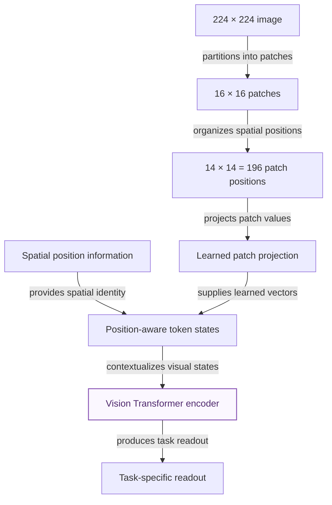

## Chapter VI.4: Vision Transformers - Images as Spatial Token Sequences

### 1. From Spatial Hierarchies to Spatial Token Sequences

VI.3 built $H_{\mathrm{img}}$ through convolution: local kernels, weight sharing, spatial feature maps, downsampling, and depth.

A Vision Transformer constructs the same kind of chapter-level object - a structured visual representation - through a different computation.

Part IV established the Transformer as a sequence-processing architecture. A Transformer receives vector states, lets them exchange information through self-attention, transforms them through FFNs, and repeats this process across blocks. An image instead begins as a two-dimensional grid.

The visual representation problem becomes:

> How can image measurements become a sequence of states without losing the spatial distinctions that make the image useful?

The basic Vision Transformer, or ViT, divides the image into regions, maps each region into a vector, attaches spatial information, and passes the resulting sequence through Transformer blocks.[1]

image measurements → image patches → projected patch states → spatial information → Transformer blocks → contextualised visual states $H_{\mathrm{img}}$ → task readout

Attention itself is not the new mechanism here. Part IV already owns it. The new visual primitive is the spatial token sequence, and the central trade-off begins before the first self-attention layer: which image distinctions remain separate as states, and how many such states can the model afford to process?

### 2. Patchifying an Image

Return to the cover used in Chapter VI.2. It is a $1024\times1536$ image containing large structures, small text, thin strokes, distant mountains, a boat, and a human figure. A CNN can begin directly from the spatial grid and slide local transformations across it. A plain ViT first partitions the grid into non-overlapping rectangular regions called **patches**.

Imagine drawing a regular grid over the cover. Each grid cell becomes one patch. The patches can then be listed in a fixed order, usually row by row, to form a sequence.

The operation sounds similar to text tokenisation, but the analogy has limits. A language token is selected from a discrete vocabulary. An image patch begins as a block of continuous measurements. The patch is not a semantic word. It is simply a local region whose measurements will be converted into a model state.

Four objects must stay distinct:

```text
patch
-> one local image region

flattened patch
-> the same raw measurements rearranged into one vector

patch embedding
-> a learned projection of that vector

contextualised patch state
-> the resulting state after Transformer blocks
```

Flattening changes the arrangement of numbers. Projection changes the representation. Contextualisation changes the state again by letting it interact with other visual states.

This distinction is important because information can be lost at each stage for different reasons. A patch may already be too large for a tiny object to remain separable. A projection may compress raw measurements. Later attention may fail to connect relevant regions. A final readout may compress many patch states into one image-level vector.

### 3. The 224 x 224 Trace: Grid to 196 Visual States

Let an image have height $h_{\mathrm{img}}$, width $w_{\mathrm{img}}$, and $c_{\mathrm{img}}$ channels. Let each non-overlapping patch have height $P_h$ and width $P_w$. When the image dimensions divide evenly by the patch dimensions, the number of patches is

$$
N_p
=
\frac{h_{\mathrm{img}}}{P_h}
\frac{w_{\mathrm{img}}}{P_w}.
\tag{eq VI.4.1}
$$

Consider the canonical $224\times224$ RGB example with $16\times16$ patches. The image contains

$$
\frac{224}{16}\times\frac{224}{16}
=
14\times14
=
196
$$

patches. Each patch contains

$$
16\times16\times3
=
768
$$

raw values.

For a batch of $B$ images, the tensor can therefore be reorganized conceptually as

```text
B × 3 × 224 × 224
-> B × 196 × 768
```

The first shape is a batch of spatial RGB grids. The second is a batch of 196 local measurement vectors. No learning has happened merely because the array was reshaped.

The full input trace can now be read before its pieces are derived further:

image $224\times224\times3$ → $196$ patches → $196$ raw vectors of width $768$ → shared learned projection → $196$ vectors of width $d_{\mathrm{vis}}$ → spatial position information → Transformer blocks → contextualised visual states $H_{\mathrm{img}}$

This is the first place where visual resolution becomes sequence length. At fixed patch size, more image area means more patches and therefore more states for the Transformer to process.

### 4. From Patch Measurements to Patch Embeddings

A flattened patch is still a vector of raw local measurements. A Transformer needs hidden states of its model width. The ViT therefore applies a learned linear projection to every patch vector:

$$
e_i^{(\mathrm{patch})}
=
x_i^{(\mathrm{flat})}W_p+b_p,
\qquad
e_i^{(\mathrm{patch})}\in\mathbb R^{d_{\mathrm{vis}}}.
\tag{eq VI.4.2}
$$

Here $x_i^{(\mathrm{flat})}$ is the flattened raw vector from patch $i$, $W_p$ and $b_p$ are learned parameters, and $e_i^{(\mathrm{patch})}$ is the projected visual state.

The same projection parameters are reused for every patch. That gives ViT a form of spatial parameter sharing, although it is not the same local computation pattern as a CNN. A CNN repeatedly applies a local kernel while preserving a spatial feature-map grid through many layers. A basic ViT applies the same patch projection once, then moves the resulting states into Transformer computation.

There is also a useful implementation bridge between the two architectures. Extracting non-overlapping $P_h\times P_w$ patches and applying the same linear projection to each patch can be implemented as a convolution whose kernel size and stride equal the patch size. In the $16\times16$ example, one $16\times16$ stride-16 convolution can produce the initial patch embeddings directly.

That equivalence concerns the input projection. It does not make the rest of the CNN and ViT computations equivalent. After the projection, the CNN continues with spatially local convolutional structure, while the plain ViT exposes the projected patch states to Transformer blocks.




*Figure VI.4.1 — Image patches become spatially positioned tokens. This worked example has 196 nonoverlapping patches before any extra tokens. Patching turns spatial input into a sequence but preserves position only through the architecture’s chosen encoding.*

### 5. A Sequence Still Needs Two-Dimensional Position

Patchification creates a sequence, but the sequence order alone does not yet provide the Transformer with a useful learned account of two-dimensional layout.

Imagine cutting an image into patches, keeping every patch content unchanged, and then rearranging those patches into a different picture. The set of local contents could be identical while the global image becomes completely different. A face with its eyes, mouth, and nose rearranged is not the same face. A document with a table column moved elsewhere changes which values belong together.

Self-attention operates on states. Without some spatial signal, the computation has no principled basis for distinguishing "this patch is above that patch" from "this patch is below it" merely from their contents.

A simple position-aware input can be written as

$$
h_i^{(0)}
=
e_i^{(\mathrm{patch})}
+
p_i^{(\mathrm{spatial})},
\tag{eq VI.4.3}
$$

where $p_i^{(\mathrm{spatial})}$ supplies information about the spatial identity of patch $i$.

The exact mechanism varies. Positions can be learned directly, represented relatively between patch pairs, factorized by row and column, encoded through rotary-like mechanisms, or supplied through another spatial construction. The implementation can change while the requirement remains:

> Patches that contain similar local content but occupy different spatial relations must be distinguishable when the task depends on those relations.

CNNs preserve position implicitly through the feature-map grid. ViTs convert the grid into a sequence, so spatial organisation must survive that conversion through the representation or the interaction mechanism.

### 6. What the Transformer Adds

Once the model has position-aware patch states, the rest of the basic ViT can reuse the Transformer machinery from Part IV. Each Transformer block contains a self-attention layer and a feed-forward layer, together with normalisation and residual connections.

Before contextualisation, one patch state primarily contains information derived from one local region. After several Transformer blocks, each patch state can incorporate information from other regions.

On the guide cover, a patch around the boat can interact with patches around the human figure, distant mountains, the water, the circular symbol, or the title. A patch representing one part of a chart can interact with a distant legend. A patch around a document heading can interact with content farther down the page.

The architectural difference from a plain CNN is the interaction graph. A convolution begins from local edges in that graph. Distant regions influence one another only after information has propagated through repeated local operations, larger kernels, dilation, downsampling, or another non-local mechanism. Full self-attention creates a direct interaction route between any pair of patch states in one self-attention layer.

Direct access is capability of the architecture, not proof of useful global reasoning. The model must still learn attention patterns and feature transformations that exploit the relevant relations. A direct path between two patches can be unused, noisy, or misleading.


*Figure VI.4.2: A Vision Transformer converts image patches into position-aware states, contextualizes them through Transformer blocks, then produces task-specific readouts.*

### 7. CNN and ViT Encode Different Architectural Priors

CNNs and ViTs do not differ because one has inductive bias and the other does not. Both architectures restrict the functions that are easy to represent and learn. They simply encode different assumptions.

| Property | CNN | Plain ViT |
|---|---|---|
| Initial visual primitive | Local shared kernel | Projected image patch |
| Spatial organisation | Explicit feature-map grid | Sequence plus spatial information |
| Early interaction | Local | Potentially global |
| Parameter reuse | Shared local operators across position | Shared patch projection and Transformer-block parameters across states |
| Long-range relation | Built through depth or added non-local mechanisms | Direct pairwise access under full attention |
| Resolution reduction | Commonly built into stages | Optional; basic ViT can remain flat |
| Main early bottleneck | Kernel/local-stage design and downsampling | Patch size and patch projection |

A CNN therefore starts with stronger locality and translation-oriented structure. A plain ViT gives every patch state a more flexible interaction pattern but begins by imposing a patch grid and a positional scheme.

The practical consequence is not that ViT "removes assumptions." It relocates them. Patch size decides which local measurements are grouped before the main Transformer. The position mechanism decides how spatial layout enters computation. The attention topology decides which states can interact directly. The readout decides how much of the final spatial representation survives into the task output.

The comparison is therefore conditional. CNN bias can be highly efficient when local repeated structure dominates. ViT flexibility can be valuable when long-range relations matter and sufficient training pressure exists to shape useful interactions. Hybrid designs combine both.

### 8. From Patch States to an Image-Level Readout

A ViT produces a sequence of contextualised visual states. Some tasks, such as image classification or retrieval, eventually need one image-level vector.

One option is to pool the patch states. Mean pooling, attention pooling, or another aggregation can map the sequence into one vector. Another option, used by the original ViT, is to prepend a learned readout state often called a class token or `[CLS]` token.[1] That state participates in the Transformer blocks and becomes image-conditioned through interaction with the patch states.

The parameter-activation distinction matters:

```text
learned CLS starting vector
-> one shared parameter across images

final CLS state
-> one activation conditioned on the current image
```

The final activation can serve as an image representation because it has accumulated information from the image-specific sequence. The starting parameter itself is not an image representation.

Readout is also another compression boundary. A task that needs one category label can tolerate aggressive image-level compression. A task that needs exact text, object coordinates, or region-to-region relations may need the structured patch states to remain available instead of collapsing immediately into one vector.

### 9. Resolution Becomes Sequence Length

At fixed patch size, image resolution determines patch count. The $224\times224$ example with $16\times16$ patches produces 196 states. Doubling both image dimensions to $448\times448$ gives

$$
N_p
=
\frac{448}{16}
\frac{448}{16}
=
28\times28
=
784.
\tag{eq VI.4.4}
$$

The image dimensions doubled, the area became four times larger, and the visual sequence became four times longer.

The guide cover makes the same pressure more concrete. Its native resolution is $1024\times1536$. If it were processed directly with non-overlapping $16\times16$ patches, the patch grid would contain

$$
\frac{1024}{16}\times\frac{1536}{16}
=
64\times96
=
6144
$$

states.

That calculation is illustrative rather than a claim about how a production vision system should process the cover. A real system might resize the image, use larger patches, tile it, process several scales, merge states hierarchically, or select regions. The point is structural: **visual resolution becomes sequence length once image regions become Transformer states**.

The relation creates a direct systems trade-off. Higher resolution can preserve smaller text, thinner lines, tiny objects, and subtle boundaries. The same detail produces more states, more activation memory, more interaction work, and more downstream context pressure.

### 10. Why Global Attention Becomes Expensive

Part IV showed that self-attention compares Query and Key states. For $N_p$ visual states, unrestricted all-pairs attention creates an $N_p\times N_p$ score matrix per attention head.

For 196 patch states, the number of score positions is

$$
196^2
=
38{,}416.
\tag{eq VI.4.5}
$$

For 784 patch states, it becomes

$$
784^2
=
614{,}656.
\tag{eq VI.4.6}
$$

Doubling both image dimensions therefore creates four times as many states and sixteen times as many pairwise score positions under full attention.

The native-resolution guide-cover illustration is more extreme:

$$
6144^2
=
37{,}748{,}736.
\tag{eq VI.4.7}
$$

That is almost 38 million score positions per head in one full self-attention layer before accounting for Query, Key, and Value projections, feed-forward layers, activations, memory movement, batching, or multiple Transformer blocks.

The $N_p^2$ term therefore describes one important cost component, not the complete computational cost of a ViT. On modern hardware, wall-clock performance also depends on tensor shapes, memory bandwidth, kernel implementations, batching, numerical precision, and whether the architecture uses full or restricted attention.

The causal lesson is narrower and more durable: when visual detail creates more patch states, **the cost of allowing every state to interact directly with every other state rises much faster than the state count itself**.

### 11. Patch Size Is the First Evidence-Cost Trade-off

Patch size determines how much local image structure is combined before the main Transformer can reason over it as separate states.

At fixed image resolution, smaller patches create more states. More local distinctions survive as separate objects for later attention, but sequence length and interaction cost rise. Larger patches create fewer states and reduce downstream cost, but they perform earlier spatial compression.

Return again to the guide cover. A large patch may contain several small character strokes from the subtitle, part of the boat, the human figure, or thin mountain details inside one projected vector. The projection can still preserve useful information inside that vector, but later attention can no longer access those raw subregions as independent patch states unless the representation has encoded their distinctions internally.

This is VI.2's irrecoverable-loss boundary in a concrete visual form. If two distinct local configurations produce the same patch representation, later Transformer blocks receiving only that state cannot recover which configuration occurred from that representation alone.

Patch size therefore is not only a computational hyperparameter. It is an **information-allocation decision**:

> How early should nearby visual measurements be compressed together, and how many independent local states can later computation afford?

FlexiViT makes this trade-off explicit by training one set of model weights to operate across multiple patch sizes, allowing deployment to choose different compute-accuracy operating points without training a completely separate model for every patch size.[5] The broader principle is older and more general: patch size chooses where the first major representation bottleneck sits.

### 12. Scaling Visual Interaction

The basic ViT is intentionally simple, but its simplicity exposes several bottlenecks. Later vision Transformers can be understood as targeted repairs rather than as a catalogue of unrelated architectures.

**Local windows** reduce the number of direct pairwise interactions. Suppose the $28\times28$ patch grid from the $448\times448$ example is split into four non-overlapping $14\times14$ windows. Each window contains 196 states, so one windowed self-attention layer would create approximately

$$
4\times196^2
=
153{,}664
$$

within-window score positions instead of $614{,}656$ positions for one global matrix. The saving comes from removing direct edges between windows in that self-attention layer. Cross-window communication must then be restored elsewhere. Swin Transformer uses shifted windows and a hierarchical structure precisely to combine local efficiency with communication across neighboring windows and multiple scales.[3]

**Hierarchy and merging** reduce the number of states as depth increases. Early stages can preserve fine local detail; later stages can operate on coarser states with larger effective spatial scope. This resembles the resource logic of CNN stages without making the operations identical. Both architectures face the same physical pressure: dense high-resolution states are valuable early and expensive to preserve indefinitely.

**Sparse or selective interaction** changes which state pairs communicate directly. Instead of paying for every pair, the model can restrict attention to neighborhoods, selected regions, learned sparse patterns, or occasional global states. Every restriction saves interaction work by making some routes indirect or unavailable in that self-attention layer.

The recurring design question is therefore:

> Which regions must remain separate, and which pairs of regions need a direct interaction path at this stage?

That question links representation quality to interaction cost.

### 13. Variable Resolution, Tiling, and Global Coherence

Fixed square resizing makes training and batching convenient, but real visual inputs vary in aspect ratio and useful resolution. A panoramic image, a portrait cover, a dense document page, and a narrow phone screenshot do not naturally contain the same spatial structure.

Resizing everything to one fixed square can destroy information in two ways. Downscaling can erase small evidence. Geometric distortion or aggressive cropping can change or remove spatial relations. A multimodal system that needs tiny document text therefore faces a different resolution requirement from one that only needs broad scene recognition.

Native or dynamic resolution lets token count follow the chosen image scale and aspect ratio instead of forcing every input to one fixed grid. Changing the patch grid also changes the positional problem. A ViT trained with a fixed learned position table on a $14\times14$ patch grid cannot simply reuse that table unchanged on a $28\times28$ grid. The original ViT handled higher-resolution fine-tuning by interpolating its learned position embeddings in two dimensions; other systems use relative, factorized, rotary-like, or otherwise grid-general position mechanisms. Native-resolution processing therefore requires both a variable number of visual states and a position representation that remains coherent as the grid changes. NaViT, for example, was designed to process images at varied resolutions and aspect ratios through sequence packing and to expose input resolution as an inference-time cost-performance choice.[1][4]

Another response is **tiling**. A high-resolution image can be divided into crops so that local details remain large enough to encode. Tiling protects detail but creates a new boundary problem. A word can cross two tiles. A chart label can sit in one tile while the corresponding line appears in another. A small object can be separated from the scene that gives it meaning.

Systems therefore combine techniques such as overlapping crops, global low-resolution views, tile-position metadata, local high-resolution views, and later cross-tile interaction. Each method decides where to spend the evidence budget.

The core trade-off is:

```text
resize aggressively
-> cheaper
-> risk losing fine evidence

tile or preserve native detail
-> richer local evidence
-> more states and coordination

compress later
-> delay information loss
-> pay more early computation
```

The solution is task-dependent. A system reading small text may rationally preserve far more local detail than a system performing coarse image retrieval.

### 14. What Training Must Compensate For

Architecture determines which visual functions are easy to express. Training determines which useful functions are actually learned.

A CNN begins with strong locality and translation-oriented parameter sharing. A plain ViT begins with patch projection, spatial information, and flexible state interaction. It therefore supplies weaker built-in assumptions about local visual structure than a conventional CNN and leaves more of that structure for data and optimisation to shape.

The original ViT work made this dependence visible. Pure Transformers applied to patch sequences became highly competitive when pretrained at large scale and transferred to standard recognition tasks.[1] The result showed that convolution was not required for strong visual recognition, but it also highlighted that the training regime matters when less visual structure is built into the architecture.

DeiT later showed that competitive convolution-free ViTs could be trained using ImageNet alone with a carefully designed recipe and, in one variant, transformer-specific distillation.[2] The important lesson is not that one paper overturned another. It is that **architecture, data scale, augmentation, regularization, optimisation, and supervision jointly determine the learned visual model**.

The chapter therefore preserves the level separation introduced in VI.2:

```text
ViT architecture
!=
ViT learned representation
!=
training objective
!=
training recipe
```

A ViT can be trained for classification, self-supervision, image-text alignment, or other objectives. Those objectives create different representation pressure. Part VI later gives cross-modal learning and multimodal training their own chapters; VI.4 only establishes the architecture-specific consequence that weaker built-in locality makes the training regime especially consequential.

### 15. Failure Modes and Diagnostic Questions

A ViT failure can often be localised by tracing the visual evidence from preprocessing through patchification, spatial encoding, interaction, and readout.

| Observable failure | Likely mechanism | Diagnostic question |
|---|---|---|
| Tiny text or object disappears | Resize, patch scale, or early projection removed the distinction | At what image scale or patch representation does the detail cease to be recoverable? |
| Correct local contents, wrong spatial relation | Position representation is weak or poorly learned | Does the model-visible state distinguish the relevant 2D arrangements? |
| Distant relation remains weak | Interaction path exists but training does not use it effectively, or restricted attention delays contact | Where can the two regions first influence the same state? |
| High-resolution input becomes expensive | Resolution created too many states for the attention topology | Which state count and interaction pattern dominate memory and compute? |
| Crop or tile omits necessary evidence | Region selection removed the evidence before encoding | Was the relevant region ever model-visible? |
| Relation breaks across tile boundaries | Local detail was preserved but global coherence was weakened | Where can separated tiles exchange position-aware evidence? |
| One image vector loses exact detail | Readout compressed structured states too early | Which pre-readout states still preserve the needed detail? |
| Attention map is presented as proof of reasoning | Architectural routing signal is overinterpreted as causal explanation | Does the visualisation establish that the attended relation caused the output? |

The diagnostic discipline is the same one established in VI.2 and applied to CNNs in VI.3: locate the earliest representation where necessary evidence disappeared, became misbound, or lost an effective interaction route.

A fluent downstream answer can hide an upstream visual failure. If a tiny subtitle is removed during resize, the language model may still guess plausible text. The plausibility of the answer does not restore the missing evidence.

### 16. From Spatial Tokens to Temporal Evidence

CNNs and Vision Transformers provide different constructions of the same durable object: structured visual states $H_{\mathrm{img}}$.

Both begin from spatial evidence. Audio changes the axis along which evidence is organised. A waveform unfolds through time, and the useful distinctions may depend on timing, frequency structure, overlap, pauses, speaker changes, or non-speech events.

The next representation step is therefore:

audio $x_{\mathrm{aud}}$ → audio encoder $E_{\mathrm{aud}}$ → structured acoustic states $H_{\mathrm{aud}}$

VI.5 develops that temporal evidence problem before any cross-modal comparison or fusion is introduced.

### 17. Companion Code

[sampleViT](https://github.com/phtuananh-pro/sampleViT) provides a small image-classification example built around a Vision Transformer. Readers can follow the conversion from image patches to visual token representations and inspect how Transformer computation produces a prediction, then run the example using the repository README. It is a compact illustration of the mechanism rather than a production vision system.

### 18. Key Takeaways

- A Vision Transformer converts local image regions into vector states, adds spatial information, and contextualizes those states with Transformer blocks.
- A patch, flattened patch, patch embedding, and contextualised patch state are different objects.
- Patch size determines the first major evidence bottleneck: smaller patches preserve more independent local states at greater computational cost; larger patches compress earlier.
- Converting a grid into a sequence makes spatial representation explicit. Similar patch contents in different arrangements must remain distinguishable when the task depends on layout.
- Full self-attention changes the interaction graph by giving distant patches a direct route to one another. Direct access does not guarantee that training will learn the useful relation.
- ViT and CNN encode different inductive biases. ViT does not eliminate architectural assumptions; it relocates them into patching, position, interaction topology, readout, and training.
- Image resolution becomes visual sequence length. Under unrestricted attention, pairwise score positions grow approximately with the square of the number of patch states.
- Windows, hierarchy, native resolution, tiling, and flexible patch sizes are different responses to the same evidence-cost problem: preserve useful detail without making every visual distinction equally expensive.
- Failure localisation begins before the final answer: inspect preprocessing, patch scale, position, interaction routes, tile boundaries, and readout before attributing an error to downstream reasoning.

### 19. References

[1] Alexey Dosovitskiy et al., [“An Image Is Worth 16×16 Words: Transformers for Image Recognition at Scale,”](https://arxiv.org/abs/2010.11929) *International Conference on Learning Representations*, 2021.

[2] Hugo Touvron et al., [“Training Data-Efficient Image Transformers & Distillation Through Attention,”](https://proceedings.mlr.press/v139/touvron21a.html) *Proceedings of the 38th International Conference on Machine Learning*, 2021.

[3] Ze Liu et al., [“Swin Transformer: Hierarchical Vision Transformer Using Shifted Windows,”](https://arxiv.org/abs/2103.14030) *International Conference on Computer Vision*, 2021.

[4] Mostafa Dehghani et al., [“Patch n’ Pack: NaViT, a Vision Transformer for Any Aspect Ratio and Resolution,”](https://arxiv.org/abs/2307.06304) 2023.

[5] Lucas Beyer et al., [“FlexiViT: One Model for All Patch Sizes,”](https://arxiv.org/abs/2212.08013) *IEEE/CVF Conference on Computer Vision and Pattern Recognition*, 2023.
